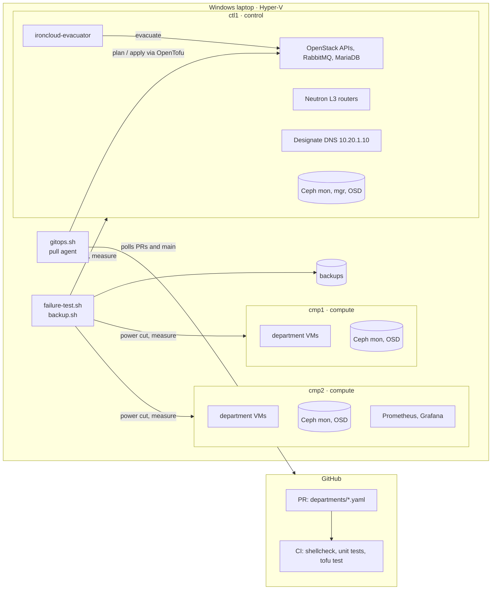

# IronCloud

A private cloud lab built from OpenStack (Kolla-Ansible) and Ceph on one laptop, with self-service environments for departments, network isolation between them, and failure tests that measure what breaks and how it recovers.

**Domains:** System Engineering · Network Engineering · Platform Engineering

## Results

Measured on this lab; each number links to the report or test that produced it.

| What was tested | Result |
|---|---|
| Power cut on a compute node | VM moved to the other node by [`ironcloud-evacuator`](platform/evacuator.sh) with no operator action, answering ping after **139 s**; data checksums intact ([report](reports/20261020-1650-cmp1-failure.md)) |
| Power cut on the controller | VMs kept running; same-network traffic lost **0 of 363** pings; disk writes paused **29 s** until Ceph marked the OSD down ([report](reports/20261020-1625-ctl1-failure.md)) |
| Department isolation | **40/40** checks from inside tenant VMs: no route or port between departments, shared DNS reachable ([test](platform/isolation-test.sh)) |
| Backup and restore | Data written, backed up (**9 s, 40 MB**), overwritten, restored (**49 s** until SSH), checksum matched ([report](reports/20261020-1651-ledger-restore-test.md)) |
| Department request over quota | Rejected at plan time, nothing created; checked in CI with mocked OpenStack ([tests](platform/tofu/tests/departments.tftest.hcl)) and on the lab per PR ([example](https://github.com/oplosy/iron-cloud/pull/1)) |
| Rebuild from scratch | Fresh VMs to a working platform with one command in **~25 min** ([runbook](docs/runbooks/rebuild-lab.md)) |

## Architecture



- **Storage:** Ceph with one OSD per node, pools `size 3 / min_size 2`; VMs boot from Ceph volumes, so a dead compute node's VMs can be rebuilt elsewhere from the same disk.
- **Departments:** `departments/<name>.yaml` (quota, CIDR, VMs) becomes a project, quotas, network, router, security groups, VMs with floating IPs and a DNS zone, one OpenTofu workspace per department ([`platform/tofu`](platform/tofu)).
- **GitOps:** a PR gets the lab's plan as a comment and a `lab/plan` status; merging applies it. The agent pulls from GitHub, so the lab is never exposed, and plans PRs with main's platform code so a PR cannot run its own code on the lab ([`platform/gitops.sh`](platform/gitops.sh)).
- **Recovery:** the evacuator acts only when Nova, ping and Ceph all report a compute node down; the RBD exclusive lock keeps a returning node from writing to a moved volume.
- **Monitoring:** Prometheus and Grafana run on `cmp2`, so they stay up when the controller dies.

## Scope and limits

One laptop, 3 nested Hyper-V VMs (`ctl1` 10 GB, `cmp1`/`cmp2` 4 GB RAM), no hardware spend. A "physical node failure" is a hard power-off of a node VM. One controller, so a controller failure stops the APIs (the [ctl1 report](reports/20261020-1625-ctl1-failure.md) shows exactly what keeps working). What is out of scope and why: [docs/roadmap.md](docs/roadmap.md#out-of-scope).

## Build and run

Windows host, Git Bash unless noted:

```bash
powershell.exe -File lab/hyperv/prepare-images.ps1   # base disk + cloud-init seeds, no admin
# then, in an elevated Windows PowerShell: lab/hyperv/new-lab.ps1
bash platform/up.sh                                   # deps, prep, ceph, openstack, evacuator (~25 min)
bash platform/up.sh smoke-test.sh                     # CirrOS VM on a Ceph volume with a floating IP
```

Departments, through a PR (see the [add-department runbook](docs/runbooks/add-department.md)):

```bash
powershell -File platform/gitops-task.ps1              # scheduled task: gitops.sh once every 5 min
bash platform/up.sh isolation-test.sh                 # pass/fail matrix from inside department VMs
```

Failure tests, backups, checks:

```bash
bash platform/failure-test.sh cmp1                    # or cmp2, ctl1; writes reports/<date>-<node>-failure.md
bash platform/backup.sh backup engineering            # boot volumes to ~/ironcloud-backups
bash platform/backup.sh test finance ledger           # back up, damage, restore, compare
bash tests/run.sh                                     # unit tests (also in CI)
```

Grafana: `http://10.20.0.13:3000`, dashboard "IronCloud overview" (user `admin`, password `grafana_admin_password` in `ctl1:/etc/kolla/passwords.yml`).

- [docs/roadmap.md](docs/roadmap.md): phases and the checks that mark each one done
- [docs/runbooks](docs/runbooks): compute, controller and OSD failure, backup and restore, add and remove a department, rebuild
- [docs/cost-plan.md](docs/cost-plan.md): lab sizing and budget
